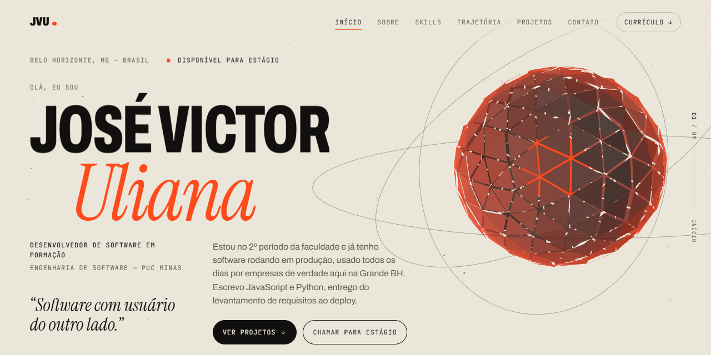

 

## José Victor Uliana

Estudante de **Engenharia de Software na PUC Minas** (2º período), em Belo
Horizonte. Desde fevereiro de 2026 atendo clientes pela **AlphaSync**, minha
marca de desenvolvimento freelancer: levanto requisitos, desenvolvo, publico e
dou manutenção.

Gosto de projeto que tem gente usando do outro lado. É o que ensina o que
nenhum exercício ensina: o que quebra, o que ninguém usa e o que realmente
precisava ser feito.

**Procuro estágio em desenvolvimento** — front-end, back-end ou full-stack,
remoto ou presencial em BH, à tarde e/ou à noite.

 

## Projetos

| Projeto | O que é | Stack |
|---|---|---|
| **AlphaSync** | Sistema de gestão para operação de ambulâncias em eventos | React · Node.js · PostgreSQL |
| **SportsLab** | PWA de gestão para academias e personal trainers | React 19 · Vite · Supabase |
| **Barbearia** | PWA mobile-first de agenda e caixa para barbearia | React · Firebase |
| **LogSync** | Análise e correção de jornadas de motoristas | Python |
| **[Portfólio](https://joseuliana.vercel.app)** | Uma cena 3D contínua que acompanha a rolagem da página — [código aberto](https://github.com/joseulianadev/portfolio) | React Three Fiber · TypeScript · GSAP |

Os quatro primeiros são privados por envolverem dados de clientes reais. O
portfólio está [no ar](https://joseuliana.vercel.app) e com o
[código aberto](https://github.com/joseulianadev/portfolio), se você quiser ver
funcionando ou ler o código antes de me chamar para conversar.

 

## Tempo de código

Quase tudo que escrevo fica em repositório privado, então o gráfico de
contribuições do GitHub não conta a história direito. O WakaTime mede o tempo
real de edição direto do editor, onde quer que o código esteja hospedado.

  

 

## Linguagens e ferramentas

A lista é curta de propósito: cada item eu consigo explicar e mostrar onde
usei. O que ainda está em estudo entra quando virar prática.

&nbsp;
&nbsp;
&nbsp;
&nbsp;
&nbsp;
&nbsp;
&nbsp;
&nbsp;
&nbsp;
&nbsp;
&nbsp;

**Processo:** levantamento de requisitos · Kanban · Scrum · XP · IA aplicada ao desenvolvimento

 

## Como eu trabalho

**Procuro a causa antes da correção.** Quando algo quebra, não me contento com
o ajuste que faz o sintoma sumir. Se eu não entendi por que aconteceu, sei que
vai voltar.

**Não aceito "está pronto" sem ver.** Nem quando é meu. Antes de dar algo por
resolvido, quero ver funcionando de verdade.

**Escuto quem usa.** As melhores decisões que tomei vieram de quem usa o
sistema todo dia reclamando de algo específico. Já tirei funcionalidade inteira
do ar por não ter ninguém usando, e o produto ficou melhor sem ela.

 

## Contato

Respondo rápido, aceito teste técnico e mostro código e projetos em produção
numa conversa de 20 minutos.

**[ulianajosee@gmail.com](mailto:ulianajosee@gmail.com)** ·
**[linkedin.com/in/joseuliana](https://www.linkedin.com/in/joseuliana/)** ·
**[joseuliana.vercel.app](https://joseuliana.vercel.app)**
