  

  
  
  

  

 

### Sobre

Estudante de **Engenharia de Software na PUC Minas**, em Belo Horizonte. Desde
fevereiro de 2026 atendo clientes pela **AlphaSync**, minha marca de
desenvolvimento freelancer: levanto requisitos, desenvolvo, publico e dou
manutenção.

Gosto de projeto que tem gente usando do outro lado. É o que ensina o que
nenhum exercício ensina: o que quebra, o que ninguém usa e o que realmente
precisava ser feito.

Os projetos de cliente são privados por envolverem dados reais. O portfólio
está [no ar](https://joseuliana.vercel.app) e com o
[código aberto](https://github.com/joseulianadev/portfolio).

 

### Linguagens e ferramentas

A lista é curta de propósito: cada item eu consigo explicar e mostrar onde usei.

  &nbsp;
  &nbsp;
  &nbsp;
  &nbsp;
  &nbsp;
  &nbsp;
  &nbsp;
  &nbsp;
  &nbsp;
  &nbsp;
  &nbsp;
  

Processo: levantamento de requisitos · Kanban · Scrum · XP · IA aplicada ao desenvolvimento

 

### Tempo de código

Quase tudo que escrevo fica em repositório privado, então o gráfico de
contribuições do GitHub não conta a história direito. O WakaTime mede o tempo
real de edição direto do editor.

  
    
  

 

### Contato

**[ulianajosee@gmail.com](mailto:ulianajosee@gmail.com)** ·
**[linkedin.com/in/joseuliana](https://www.linkedin.com/in/joseuliana/)** ·
**[joseuliana.vercel.app](https://joseuliana.vercel.app)**

Os cards acima são SVGs animados gerados por <a href="./scripts/render-cards.mjs">um script</a> deste repositório.
